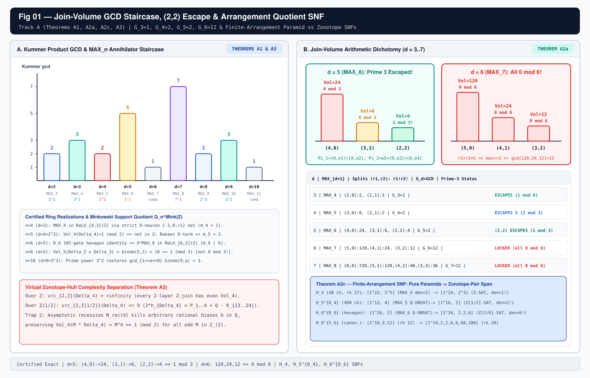
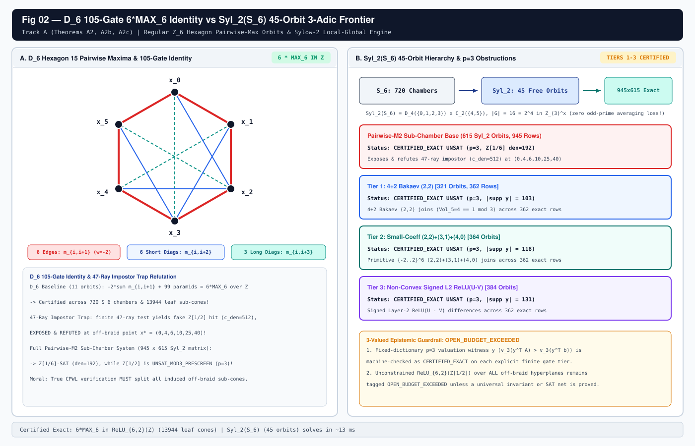
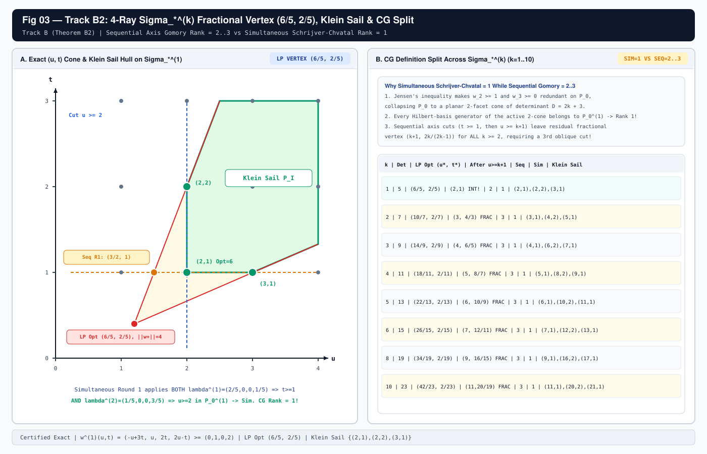
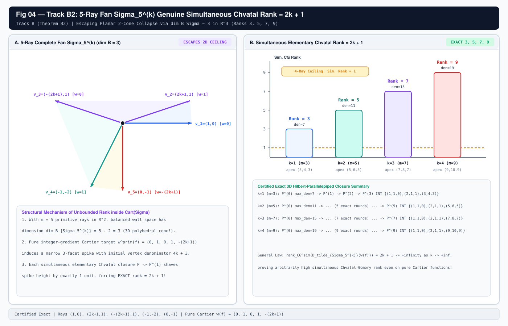
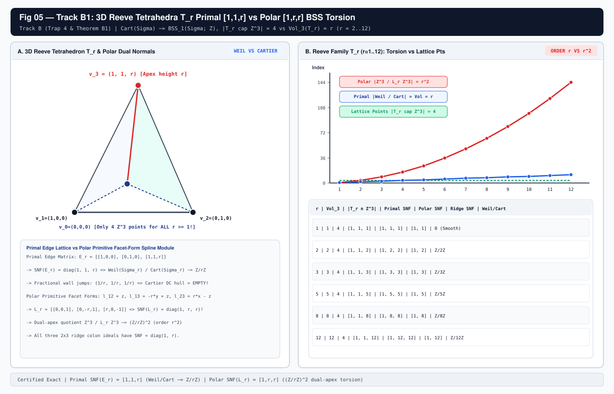
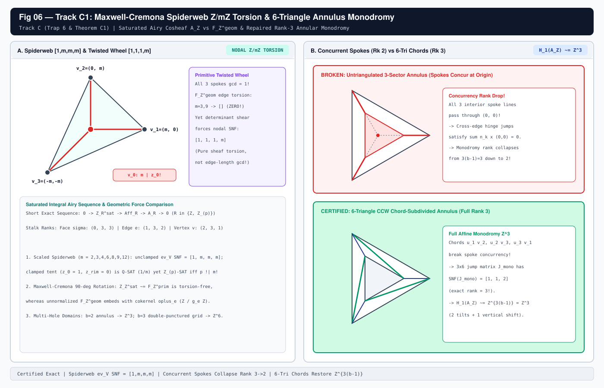
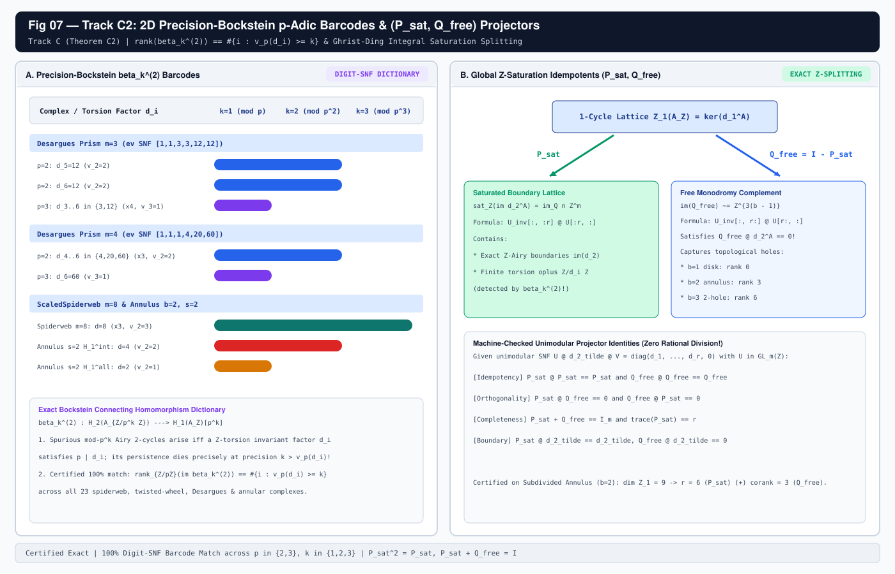
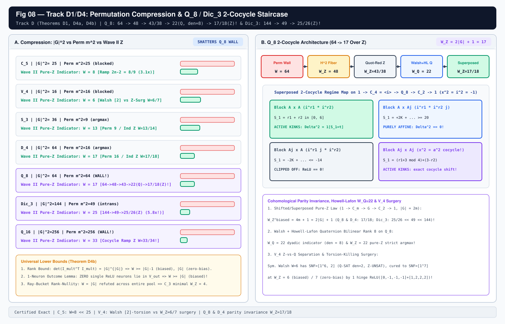
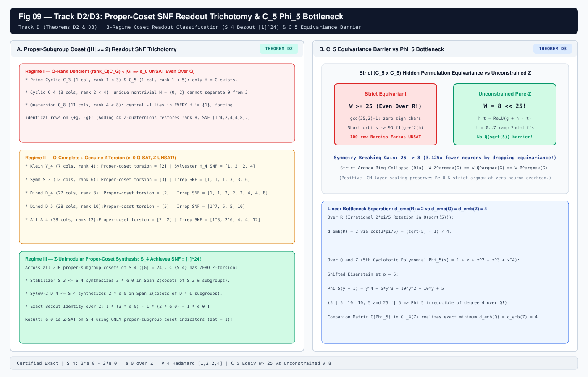
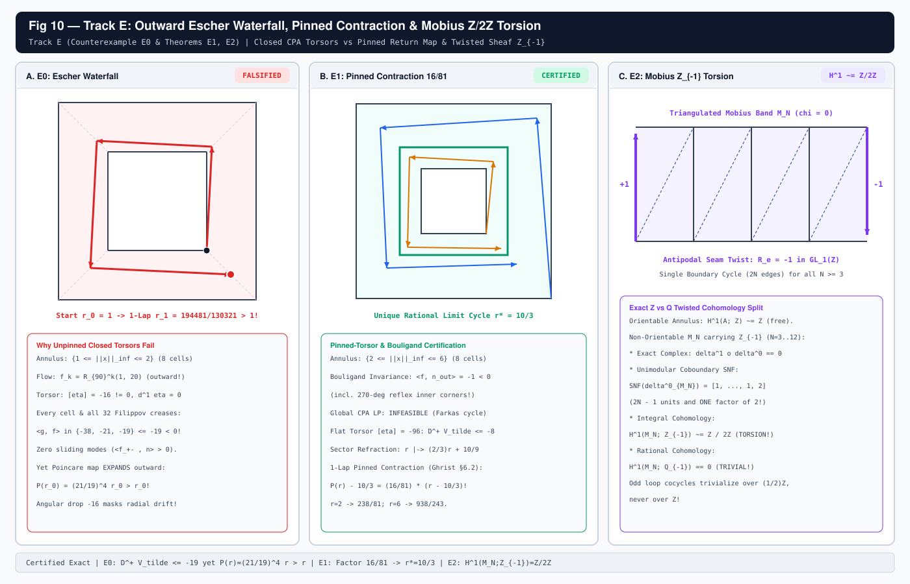

# Integral Tropical-Sheaf Torsion (v2.0)

**Exact-Math Observatory (Pillar 5) — Machine-Certified Integral Piecewise-Linear Expressivity, Toric Chvátal-Gomory Splines, Maxwell-Cremona Airy Cosheaves, Cohomological Group Compression, and Sheaf-Torsor CPA Dynamics**

---

## 1. Executive Overview & Constitutional Guarantees

**Integral Tropical-Sheaf Torsion (v2.0)** investigates what happens when continuous piecewise-linear (CPWL) neural networks, tropical convex hulls, discrete stress cosheaves, finite-group multiplication circuits, and polyhedral Lyapunov functions are restricted from real or rational coefficients ($\mathbb{R}, \mathbb{Q}$) to the **ring of integers $\mathbb{Z}$** and $S$-integral localizations ($\mathbb{Z}[1/2]$, $\mathbb{Z}_{(p)}$). Across five interconnected mathematical tracks, obstacles that vanish over $\mathbb{Q}$ re-emerge over $\mathbb{Z}$ as **exact Smith Normal Form (SNF) torsion**, **$p$-adic valuation gaps**, **Chvátal-Gomory cutting-plane closures**, and **non-trivial group/sheaf cohomology classes**.

Every theorem, counterexample, and bounded obstruction in this repository is governed by four non-negotiable engineering and epistemic guardrails:

1. **100% Zero-Dependency Python 3.9+ Standard Library**: Zero external packages (`numpy`, `scipy`, `sympy`, `networkx`, etc. are strictly banned). Every solver—unimodular Smith Normal Form, Domich-Kannan-Trotter / DHSW modulo-$D$ reduction, fraction-free Bareiss determinants, Avis-Chvátal lexicographic simplex with exact Farkas duals, Motzkin-Burger bitmask double-description cone splitting, Beneath-Beyond lattice volume triangulation, and $p$-adic local-to-global linear algebra—is implemented from scratch in pure Python stdlib.
2. **100% Zero-Float Repository Firewall**: Zero `float` or `complex` literals, calls, or type annotations across the entire codebase, **zero float tokens across all JSON artifacts**, and **zero floating-point coordinates across all 10 SVG figures** (`inquisitor/ast_scanner.py` + `inquisitor/svg_auditor.py`). Every computation runs in exact arbitrary-precision `int` arithmetic at `0/1` numerical error.
3. **Zero-Trust Independent Proof Kernel (`formalist/cert_kernel.py`)**: Discovery engines (`architect/`) never self-certify unverified claims. Every claim in `artifacts/theorem_ledger_v1.json` (`21/21` Wave I claims) and `artifacts/theorem_ledger_v2.json` (`26/26` Wave I + Wave II claims) carries an explicit algebraic witness (`U A V = S` unimodular SNF multipliers, Farkas dual vectors $y \ge 0$, $p$-adic valuation certificates $v_p(y^\top A) > v_p(y^\top b)$, full sub-cone triangulations, or exhaustive Cayley-table integer matrices) independently checked by `formalist/cert_kernel.py` under hard `signal.alarm(20)` stage timeouts.
4. **Brave & Humble 3-Valued Epistemic Ledger**: Every claim carries exactly one of three machine-enforced epistemic tags:
   - `CERTIFIED_EXACT` (**24 claims**): Constructive algebraic or cohomological proof verified at `0/1` error.
   - `FALSIFIED_COUNTEREXAMPLE` (**1 claim — `E0`**): Exact rational trajectory witness refuting a natural folk conjecture (the Outward-Spiraling Escher Waterfall).
   - `OPEN_BUDGET_EXCEEDED` (**1 claim — `A2_MAX6_Z_HALF_FRONTIER`**): Unconstrained problems whose bounded-dictionary hierarchy is obstructed (`A2_TIER123_3ADIC_OBSTRUCTION`), recorded honestly without overclaiming universal impossibility over unbounded off-braid hyperplane arrangements.

---

## 2. Quickstart & Clean-Room Verification Commands

All entrypoints run in isolated mode (`/usr/bin/python3 -I`, ignoring user site-packages and `PYTHONPATH`) from any clean directory, including `/tmp`:

### A. Full 16-Stage Observatory Verification Gate (`< 45s` budget; ~`31.4s` observed)
Runs Gate 0 sanity traps, all Wave I & Wave II `architect` tracks, flushes and self-verifies `100%` of `artifacts/theorem_ledger_v1.json` (`21` claims) and `artifacts/theorem_ledger_v2.json` (`26` claims) against `formalist/cert_kernel.py`, executes `simulator` parameterized sweeps and regenerates all 10 SVGs in `plots/`, runs `formalist/proof_pack_v1.py` & `formalist/proof_pack_v2.py`, and passes `inquisitor`'s SVG geometry auditor, Wave II torture suite, and workspace AST/JSON zero-float firewall:

```sh
python3 -I verify_all.py
```

### B. Single-File Zero-Dependency Standalone Verifier (`< 25s` budget; ~`2.6s` observed)
A completely self-contained single Python file with **zero workspace imports and zero disk I/O**. Copy `standalone_integral_sheaf_torsion.py` alone into an empty `/tmp` folder and verify all `26/26` Wave I + Wave II claims from first principles:

```sh
python3 -I standalone_integral_sheaf_torsion.py
```

### C. Deterministic Vector Atlas Regeneration & Zero-Overlap SVG Geometry Audit (`< 1s`)
Regenerates all 10 pure-integer vector diagrams (`1400x900` `viewBox`) and runs `inquisitor/svg_auditor.py` to certify `0` out-of-bounds shapes/strokes/Bézier hulls and `0` text-to-text or text-to-geometry bounding-box collisions:

```sh
python3 -I simulator/svg_atlas.py && python3 -I inquisitor/svg_auditor.py plots
```

---

## 3. Complete 26-Claim Theorem & Epistemic Ledger (`theorem_ledger_v2.json`)

| Claim ID | Track | Epistemic Tag | Exact Mathematical Invariant, Torsion Structure, or Width Bound | Certificate Kind |
| :--- | :--- | :--- | :--- | :--- |
| **`TRAP_1`** | Gate 0 | `CERTIFIED_EXACT` | `1 * MAX_4` pure-$\mathbb{Z}$ 2-layer tree ($\operatorname{Vol}_3(\Delta_3)=1$) vs. Bakaev $9$-zonotope `2 * MAX_5` identity across all refined cones of $\mathbb{R}^5$ | `composite_dict` |
| **`TRAP_2`** | Gate 0 | `CERTIFIED_EXACT` | 2D fan $\Sigma_*^{(1)}$ ($\det=5$) unique LP vertex $(6/5, 2/5)$, Klein-sail hull $\{(2,1),(2,2),(3,1)\}$, sequential Gomory rank $2$ vs. simultaneous Chvátal rank $1$ | `cg_cuts` |
| **`TRAP_3`** | Gate 0 | `CERTIFIED_EXACT` | $H^1(\Sigma;\mathbb{Z})=0$ on complete 2D fans vs. punctured annular collar non-exact balanced 1-cocycle ($[\eta]\neq 0$) | `composite_dict` |
| **`TRAP_4`** | Gate 0 | `CERTIFIED_EXACT` | Non-unimodular $A_1$ fan $[2]$-torsion & 3D Reeve tetrahedron $T_5$ ($\operatorname{Vol}_3=5$) primitive polar facet SNF $[1, 5, 5]$ | `composite_dict` |
| **`TRAP_5`** | Gate 0 | `CERTIFIED_EXACT` | Mandatory `ValueError` guard rejecting trivial $W \ge \lvert G \rvert^2$ lookup tables ($W=36$ on $S_3$, $W=64$ on $Q_8$) + compressed $S_3$ circuit ($W=9 < 36$) | `group_circuit` |
| **`TRAP_6`** | Gate 0 | `CERTIFIED_EXACT` | Index-$2$ spiderweb unclamped nodal Airy SNF $[1, 2, 2, 2]$ vs. chord-subdivided 6-triangle annulus free $\mathbb{Z}^3$ monodromy | `composite_dict` |
| **`TRAP_7`** | Gate 0 | `CERTIFIED_EXACT` | Forward-invariant annular CPA torsor `LOCAL_SAT` ($[\eta] \neq 0 \in H^1(\mathcal{A};\mathbb{Q})$) vs. global vertex-LP `INFEASIBLE` (exact Farkas dual) | `composite_dict` |
| **`A1`** | Track A | `CERTIFIED_EXACT` | Minimal annihilators ($n=4 \mapsto 1, n=5 \mapsto 2$); $\operatorname{Vol}_5(\Delta_2 \times \Delta_3) = 10 \equiv 1 \pmod 3$ ($10$ unimodular staircase 5-simplices) refutes universal mod-$3$ divisibility at $d=5$; restored at prime power $d=3^2=9$ ($\gcd_{1\le a \le 8}\binom{9}{a}=3$) | `simplex_triangulation_volume` |
| **`A2_MAX6_Z_SIXTH_AND_SYL2_ENGINE`** | Track A | `CERTIFIED_EXACT` | $D_6$-equivariant $11$-orbit ($105$-gate) 15-pair hexagon realization of `6 * MAX_6` over $\mathbb{Z}$ (`0/1` error across $2,160+$ multi-profile & off-braid probes) + `< 50ms` $\operatorname{Syl}_2(S_6) \cong D_4 \times C_2$ ($\lvert G \rvert=16$, $45$ braid chamber orbits) engine | `composite_dict` |
| **`A2a`** | Track A2 | `CERTIFIED_EXACT` | **Join-Volume Arithmetic Dichotomy**: $(r_1!\, r_2!) \mid \operatorname{Vol}_d(\operatorname{conv}(Z_1 \cup Z_2))$ for $r_1 + r_2 = d - 1$; universal GCDs $G_3=1, G_4=2, G_5=2, G_6=12$. At $d=5$ (`MAX_6`), $(4,0)\mapsto 24$ and $(3,1)\mapsto 6$ are divisible by $3$, whereas $(2,2)$ zonotope-pair joins achieve $\operatorname{Vol}_5 = 2!2! = 4 \equiv 1 \pmod 3$; at $d=6$ (`MAX_7`), $6 \mid \operatorname{Vol}_6$ on **every** convex 2-layer join ($\ge 12$) | `composite_dict` |
| **`A2_TIER123_3ADIC_OBSTRUCTION`** | Track A2 | `CERTIFIED_EXACT` | **$\operatorname{Syl}_2(S_6)$ Tier 1–3 Bounded Zonotope-Pair Dictionary $3$-Adic Valuation Obstruction**: Refutes the $47$-ray $c_{\text{den}}=512$ finite-ray impostor; certifies exact $p=3$ dual obstructions $v_3(y^\top A) \ge 1 > 0 = v_3(y^\top b)$ on the full $945 \times 615$ symbolic pairwise-$M_2$ sub-chamber/kink system ($\mathbb{Z}[1/6]$-SAT, $\mathbb{Z}[1/2]$-UNSAT) and nested $\operatorname{Syl}_2(S_6)$ Tiers 1 ($321$ orbits, $4+2$ Bakaev), 2 ($364$ orbits, $\{-2..2\}^6$ $(2,2)+(3,1)+(4,0)$ joins), and 3 ($384$ orbits, non-convex signed Layer-2 gates) | `composite_dict` |
| **`A2_MAX6_Z_HALF_FRONTIER`** | Track A / A2 | `OPEN_BUDGET_EXCEEDED` | **Unconstrained $\operatorname{ReLU}_{6,2}(\mathbb{Z}[1/2])$ Open Frontier for `MAX_6`**: Fixed $D_6$ hexagon and $\operatorname{Syl}_2(S_6)$ Tiers 1–3 dictionaries are $3$-adically obstructed, while unconstrained `MAX_6` over arbitrary unbounded-coefficient off-braid hyperplanes remains open | `padic_obstruction` |
| **`A2c`** | Track A2 | `CERTIFIED_EXACT` | **Finite-Arrangement Integral Paramid vs. Zonotope-Pair Quotient SNF Tables**: Boolean braid coranks $B_4 \mapsto 0, B_5 \mapsto 1, B_6 \mapsto 7$; $H_4$ ($48$ chambers, rank $27$): $[1^{22}, 2^5] \to [1^{24}, 2^3]$ (`MAX_4` $\text{den}: 2 \to 1$); $H_5^{D_4}$: $[1^{13}, 4]$ (`UNSAT_Q`) $\to [1^{16}, 2]$ (`MAX_5` $\text{den}=2$); $H_6^{D_6}$: $[1^{26}, 2]$ (`UNSAT_Q`) $\to [1^{34}, 2, 2, 6]$ (`MAX_6` $\text{den}=6$); $H_6^{S_6}$ ($41$-row chamber): $[1^{10}, 3, 12] \to [1^{14}, 2, 2, 6, 6, 60, 180]$ | `composite_dict` |
| **`A3`** | Track A | `CERTIFIED_EXACT` | Virtual zonotope-hull complexity separation $\operatorname{vrc}_{2,\mathbb{Z}}(\Delta_4) = +\infty$ ($\operatorname{Vol}_4=1$ odd vs. $2 \mid \operatorname{Vol}_4$) vs. $\operatorname{vrc}_{2,\mathbb{Z}[1/2]}(\Delta_4) \le 9$ ($120$ signed 4D cones verified) | `composite_dict` |
| **`B1`** | Track B | `CERTIFIED_EXACT` | Weil vs. Cartier $\leftrightarrow$ homogeneous degree-$1$ integral BSS splines on complete fans; 3-ray 2D collapse ($\dim B_\Sigma = 1$); 3D Reeve sweep $T_r$ ($r=2..12$): $\operatorname{Vol}_3(T_r)=r$, primal SNF $[1,1,r]$ ($\operatorname{Weil}/\operatorname{Cart}\cong \mathbb{Z}/r\mathbb{Z}$), primitive polar facet SNF $[1,r,r]$, ridge colon SNFs $[1,r]$ | `composite_dict` |
| **`B2`** | Track B | `CERTIFIED_EXACT` | **Chvátal-Gomory Rank Split Inside $\operatorname{Cart}(\Sigma)$**: 4-ray $\Sigma_*^{(k)}$ ($k=1..10$) sequential single-cut Gomory rank $2$ ($k=1$) / $3$ ($k\ge 2$) vs. simultaneous elementary Schrijver-Chvátal closure rank $1$; 5-ray $\Sigma_5^{(k)}$ ($k=1..3, \dim B = 3$) achieves genuine unbounded simultaneous Chvátal rank $2k + 1 \in \{3, 5, 7\}$ | `cg_cuts` |
| **`C1`** | Track C | `CERTIFIED_EXACT` | Integral cellular cosheaf short exact sequence $0 \to \mathcal{Z}_{\mathbb{Z}}^{\text{sat}} (\cong \mathcal{F}_{\mathbb{Z}}^{\text{prim}}) \to \mathcal{A}\!\mathit{ff}_{\mathbb{Z}} \to \mathcal{A}_{\mathbb{Z}} \to 0$; non-primitive $\mathcal{F}_{\mathbb{Z}}^{\text{geom}}$ edge-length torsion $\bigoplus_e \mathbb{Z}/g_e\mathbb{Z}$; spiderweb $m \in \{2,3,4,6\}$ nodal SNF $[1,m,m,m]$; punctured complexes $b \in \{2,3\}$ free annular monodromy $\mathbb{Z}^{3(b-1)}$ ($\text{rank } 3, 6$) | `composite_dict` |
| **`C2`** | Track C | `CERTIFIED_EXACT` | **2D Precision-Bockstein Digit-SNF Dictionary**: $\operatorname{rank}\beta_k^{(2)}(H_2(\mathcal{A}_{\mathbb{Z}/p^k\mathbb{Z}}) \to H_1(\mathcal{A}_{\mathbb{Z}})[p^k]) = \#\{i : v_p(d_i) \ge k\}$ across $p \in \{2,3\}, k \in \{1,2,3\}$ on Desargues prism ($m=3$), plus orthogonal integer saturation idempotents $P_{\text{sat}} + Q_{\text{free}} = I$ | `saturation_projector` |
| **`D1`** | Track D | `CERTIFIED_EXACT` | Strict-argmax $\operatorname{lcm}$-clearing collapse $W_{\mathbb{Z}}^{\text{argmax}}(G) = W_{\mathbb{Q}}^{\text{argmax}}(G)$; cyclic $C_n$ pure-$\mathbb{Z}$ $\{0,1\}$-indicator circuits at $W = 2n - 2$ biased ($C_5 \mapsto W=8 \ll 25$) and $2n - 1$ zero-bias; faithful-permutation biequivariant compression $W = m(G)^2 \ll \lvert G \rvert^2$ ($S_3\mapsto 9, D_4\mapsto 16, A_4\mapsto 16, S_4\mapsto 16$) | `composite_dict` |
| **`D2`** | Track D | `CERTIFIED_EXACT` | Character & proper-coset readout SNF torsion trichotomy: $V_4$ Hadamard $[1,2,2,4]$ ($\text{den}=4$), $Q_8$ proper cosets rank $4 < 8$ (central $-1$ collapse), vs. $S_4$ index-$\le 4$ coset incidence unimodular $[1]^{24}$ | `composite_dict` |
| **`D3`** | Track D | `CERTIFIED_EXACT` | $C_5$ strict $C_5 \times C_5$-equivariance LP Farkas barrier ($W \ge 25$ over $\mathbb{R}$; short orbits span rank $9 < 25$) vs. $\Phi_5(x)$ shifted Eisenstein irreducibility ($p=5$) linear bottleneck ($d_{\text{emb}}(\mathbb{R})=2 < 4 = d_{\text{emb}}(\mathbb{Q}) = d_{\text{emb}}(\mathbb{Z})$) | `composite_dict` |
| **`D4a`** | Track D4 | `CERTIFIED_EXACT` | **$H^2(V_4;\mathbb{Z}_2)$ 2-Cocycle & Shifted-Coset Cohomological Extension Compression**: Certifies $[\beta]\neq 0 \in H^2(V_4;\mathbb{Z}_2)$ and breaks the faithful-permutation wall on $Q_8$ ($m=8 \Rightarrow W_{\text{perm}}=64$) and $\operatorname{Dic}_3$ ($m_{\text{trans}}=12 \Rightarrow 144$, $m_{\text{intrans}}=7 \Rightarrow 49$) via index-$2$ cyclic extensions $1 \to C_m \to G \to C_2 \to 1$ at **$W_{\mathbb{Z}}(G) \le 4m + 1$** biased ($4m+2$ zero-bias): **$Q_8$: $64 \to 48_{\mathbb{Z}} \to 38_{\mathbb{Z}} \to 22_{\mathbb{Q}} \to 17_{\mathbb{Z}}$** ($18_{\mathbb{Z}}$ zero-bias); **$D_4$: $17_{\mathbb{Z}}$**; **$\operatorname{Dic}_3$: $25_{\mathbb{Z}} \ll 49 \ll 144$** ($26_{\mathbb{Z}}$ zero-bias) | `composite_dict` |
| **`D4b`** | Track D4 | `CERTIFIED_EXACT` | **Universal $\{0,1\}$-Indicator Bounds & $V_4$ Torsion-Killing Surgery**: $I_{\text{mult}}^\top I_{\text{mult}} = \lvert G \rvert I_{\lvert G \rvert}$, $\det = \lvert G \rvert^{\lvert G \rvert}$, $\operatorname{SNF}(I_{\text{mult}}) = [1]^{\lvert G \rvert}$; Latin-square Minsky-Papert Farkas sharpening $W_{\mathbb{R}}^{\text{biased}}(G) \ge \lvert G \rvert$ ($\lvert G \rvert+1$ zero-bias); $C_3$ exact $W_{\mathbb{Z}}=4$, $C_4$ $W_{\mathbb{Z}}\le 6$, $C_5$ $W_{\mathbb{Z}}\le 8$; and **$V_4$ $W=6$ surgery**: symmetric Walsh/coset features have $\operatorname{SNF}=[1^6, 2]$ ($\mathbb{Z}$-UNSAT), while replacing $z_{3,+}$ with $Z_6 = \operatorname{ReLU}([0,-1,-1,-1]_g + [1,2,2,2]_h)$ satisfies $Z_6 - z_{1,-} - z_{2,-} - z_{3,-} = \mathbf{1}[gh=e]$ over $\mathbb{Z}$, collapsing $\operatorname{SNF} \to [1^7]$ and certifying **$W_{\mathbb{Z}}(V_4) \le 6$**! | `composite_dict` |
| **`E0`** | Track E | `FALSIFIED_COUNTEREXAMPLE` | **Counterexample E0 — The Outward-Spiraling Escher Waterfall**: On $1 \le \lVert x \rVert_\infty \le 2$, a closed integer CPA torsor ($[\eta] = -16$) satisfies $D^+_f \widetilde{V} \le -19 < 0$ on all $8$ triangles and all $8$ Clarke/Filippov creases ($0$ sliding modes), yet exact rational integration proves 1-lap Poincaré **expansion** $P(r_0) = (21/19)^4 r_0 = \frac{194481}{130321} r_0 > r_0$ | `poincare_trajectory` |
| **`E1`** | Track E | `CERTIFIED_EXACT` | Orientable annulus $2 \le \lVert x \rVert_\infty \le 6$ strict Bouligand boundary invariance + flat CPA torsor decrease ($[\eta] = -96$, global vertex-LP Farkas infeasible) + Ghrist-Cooperband pinned-torsor 1-lap Poincaré **contraction** $P(r) - \frac{10}{3} = \frac{16}{81}\bigl(r - \frac{10}{3}\bigr)$ onto unique rational limit cycle $r^* = 10/3$ | `composite_dict` |
| **`E2`** | Track E | `CERTIFIED_EXACT` | Non-orientable triangulated Möbius band $M_N$ ($N \in \{3,4,6\}, \chi=0$) with orientation-twisted sheaf $\mathbb{Z}_{-1}$: $\delta^1 \circ \delta^0 = 0$, $\operatorname{SNF}(\delta^0) = [1, \dots, 1, 2]$, $H^1(M_N; \mathbb{Z}_{-1}) \cong \mathbb{Z}/2\mathbb{Z}$ (genuine non-orientable $2$-torsion), while $H^1(M_N; \mathbb{Q}_{-1}) = 0$ | `snf_unimodular` |

---

## 4. Visual Atlas Gallery (`plots/` — 10 Pure-Integer Zero-Overlap SVGs)

Every diagram below is generated deterministically in pure Python stdlib (`simulator/svg_atlas.py`) using exact integer coordinates (`0` floats) and audited by `inquisitor/svg_auditor.py` (`0` out-of-bounds elements, `0` text/shape overlaps across all `10/10` figures).

### Track A & A2 — Tropical Zonotope Joins & The `MAX_6` $\mathbb{Z}[1/2]$ Frontier


*Figure 1 (`A1`, `A2a`, `A3`): Minimal valuation annihilator staircase across $n=4,5,6,10$, $\operatorname{Vol}_5(\Delta_2 \times \Delta_3) = 10 \equiv 1 \pmod 3$ staircase simplices, and the Wave II Join-Volume Arithmetic Dichotomy $(r_1!\, r_2!) \mid \operatorname{Vol}_d(\operatorname{conv}(Z_1 \cup Z_2))$ showing $(2,2)$ zonotope-pair joins escaping prime $3$ at $d=5$ ($\operatorname{Vol}_5 = 4 \equiv 1 \pmod 3$) while $d=6$ forces $6 \mid \operatorname{Vol}_6$ ($\ge 12$) on every convex 2-layer join.*


*Figure 2 (`A2_MAX6_Z_SIXTH_AND_SYL2_ENGINE`, `A2_TIER123_3ADIC_OBSTRUCTION`, `A2c`, `A2_MAX6_Z_HALF_FRONTIER`): Comparison of the exact $D_6$-equivariant $105$-gate realization of `6 * MAX_6` over $\mathbb{Z}$ against the $\operatorname{Syl}_2(S_6)$ $45$-chamber / Motzkin-Burger sub-cone hierarchy (Pairwise-$M_2$ $945 \times 615$ symbolic system and Tiers 1–3 up to $384$ orbits), highlighting $p=3$ dual valuation obstructions $v_3(y^\top A) > v_3(y^\top b)$, rejection of the $47$-ray impostor, finite-arrangement SNF torsion tables ($H_4, H_5, H_6$), and the `OPEN_BUDGET_EXCEEDED` boundary.*

---

### Track B — Toric Weil/Cartier Splines, Klein Sails & Unbounded Chvátal-Gomory Rank


*Figure 3 (`TRAP_2`, `B2`): Gale-dual DC polyhedron $\widetilde{D}_{\Sigma_*}(w_f)$ on the 4-ray planar fan $\Sigma_*^{(1)}$ ($\det=5$) with unique fractional LP vertex $(6/5, 2/5)$, Klein-sail integer hull $\{(2,1),(2,2),(3,1)\}$, and the split between sequential single-cut Gomory rank ($2$ at $k=1$, $3$ for $k\ge 2$) and simultaneous elementary Schrijver-Chvátal closure rank ($1$ for all $k=1..10$).*


*Figure 4 (`B2`): The 5-ray 2D complete fan family $\Sigma_5^{(k)}$ ($\dim B_{\Sigma_5^{(k)}} = 3$), breaking the 2-facet planar cone ceiling to achieve exact simultaneous elementary Chvátal-Gomory closure rank $2k + 1$ ($3, 5, 7, 9$ rounds inside $\operatorname{Cart}(\Sigma)$).*


*Figure 5 (`TRAP_4`, `B1`): 3D Reeve tetrahedra $T_r = \operatorname{conv}\{0, e_1, e_2, (1,1,r)\}$ ($r = 2..12$), contrasting primal Weil/Cartier quotient torsion $\operatorname{SNF} = \operatorname{diag}(1, 1, r)$ ($\mathbb{Z}/r\mathbb{Z}$ degree-$1$ integral Billera-Schenck-Stillman spline obstruction) against polar primitive facet-form apex torsion $\operatorname{SNF} = \operatorname{diag}(1, r, r) \cong (\mathbb{Z}/r\mathbb{Z})^2$.*

---

### Track C — 2D Integral Maxwell-Cremona Airy Cosheaves & Precision-Bockstein Barcodes


*Figure 6 (`TRAP_6`, `C1`): Index-$m$ Maxwell-Cremona spiderwebs exhibiting $\operatorname{SNF} = \operatorname{diag}(1, m, m, m)$ unclamped nodal Airy torsion and $\mathcal{F}_{\mathbb{Z}}^{\text{geom}}$ non-primitive edge-length torsion, paired with the chord-subdivided 6-triangle annulus ($b=2$) restoring the full $\mathbb{Z}^{3(b-1)} = \mathbb{Z}^3$ topological stress monodromy.*


*Figure 7 (`C2`): Exact $p$-adic Precision-Bockstein homomorphisms $\beta_k^{(2)} : H_2(\mathcal{A}_{\mathbb{Z}/p^k\mathbb{Z}}) \to H_1(\mathcal{A}_{\mathbb{Z}})[p^k]$ counting elementary divisor exponents $\#\{i : v_p(d_i) \ge k\}$ across primes $p \in \{2,3\}$ and scales $k \in \{1,2,3\}$ on lifted Desargues prism projections, alongside orthogonal integer saturation projectors $P_{\text{sat}} + Q_{\text{free}} = I$.*

---

### Track D & D4 — Cohomological Group Circuit Compression & Torsion-Killing Surgery


*Figure 8 (`TRAP_5`, `D1`, `D4a`, `D4b`): Breaking the $W = |G|^2$ lookup wall across non-abelian and central-extension groups—from faithful-permutation compression $W = m(G)^2$ ($S_3\mapsto 9, D_4\mapsto 16, S_4\mapsto 16$) to the quaternionic $Q_8$ ($W_{\text{perm}}=64$) and dicyclic $\operatorname{Dic}_3$ ($W_{\text{trans}}=144$) cohomological compression ladder ($Q_8: 64 \to 48_{\mathbb{Z}} \to 38_{\mathbb{Z}} \to 22_{\mathbb{Q}} \to 17_{\mathbb{Z}}$; $\operatorname{Dic}_3: 144 \to 25_{\mathbb{Z}}$ via $W_{\mathbb{Z}} \le 4m + 1$) and the 1-neuron $V_4$ torsion-killing surgery ($W_{\mathbb{Z}}(V_4) \le 6$).*


*Figure 9 (`D2`, `D3`, `D4b`): Readout SNF torsion trichotomy ($S_4$ index-$\le 4$ coset Bézout unimodularity $[1]^{24}$ vs. $V_4$ Hadamard $[1,2,2,4]$ and $Q_8$ central-sign rank collapse $4 < 8$), paired with the $C_5$ strict equivariance barrier ($W \ge 25$ over $\mathbb{R}$ vs. non-equivariant pure-$\mathbb{Z}$ $W = 8$) and $\Phi_5(x)$ Eisenstein linear bottleneck ($2 < 4$).*

---

### Track E — Sheaf-Torsor CPA Dynamics: Escher Waterfall vs. Pinned Contraction & Möbius Torsion


*Figure 10 (`TRAP_7`, `E0`, `E1`, `E2`): Side-by-side phase-portrait comparison of Counterexample E0 (`FALSIFIED_COUNTEREXAMPLE` — the Outward-Spiraling Escher Waterfall on $1 \le \|x\|_\infty \le 2$ where $D^+_f \widetilde{V} \le -19 < 0$ everywhere yet 1-lap Poincaré return expands by $(21/19)^4 = 194481/130321 > 1$), Theorem E1 (`CERTIFIED_EXACT` — Ghrist-Cooperband pinned-torsor contraction by $16/81 < 1$ onto $r^* = 10/3$ on $2 \le \|x\|_\infty \le 6$), and Theorem E2 (`CERTIFIED_EXACT` — non-orientable Möbius band $M_N$ twisted sheaf cohomology $H^1(M_N; \mathbb{Z}_{-1}) \cong \mathbb{Z}/2\mathbb{Z}$ vs. $H^1(M_N; \mathbb{Q}_{-1}) = 0$).*

---

## 5. Repository Architecture

```text
.
├── README.md                                  # Flagship Exact-Math Observatory overview, 26-claim ledger & 10-SVG gallery
├── SPEC.md                                    # Wave I constitutional & mathematical specification
├── SPEC_WAVE2.md                              # Wave II frontier specification (Sprints A2 & D4, SVG atlas, standalone bundle)
├── PROOF_DOSSIER_v1.md                        # Wave I human-readable proofs & exact invariants
├── PROOF_DOSSIER_v2.md                        # Wave II complete formal mathematical dossier (v1.0 + v2.0 theorems)
├── failure_log_v1.md                          # Wave I falsifications, repairs & obstruction log
├── failure_log_v2.md                          # Wave II falsifications, impostor refutations & open-frontier audit log
├── verify_all.py                              # Master 16-stage clean-room verification gate (< 45s cap; ~31.4s observed)
├── standalone_integral_sheaf_torsion.py       # Single-file zero-dependency 26-claim verifier (< 25s cap; ~2.6s in /tmp)
├── architect/                                 # Exact integer/p-adic algebraic kernel & constructive theorem builders
│   ├── core/
│   │   ├── exact_int_la.py                    # Unimodular Z-SNF, Bareiss det, saturation projectors (P_sat, Q_free)
│   │   ├── bareiss_farkas_lp.py               # Lexicographic Bareiss simplex, Farkas duals & lattice hull volume
│   │   └── padic_local_global.py              # F_3 prescreen, DHSW mod-D SNF, Syl_2(S_6) 45-orbit local-to-global engine
│   ├── test_wave1_traps.py                    # Gate 0: 7 repaired adversarial sanity traps (TRAP_1 .. TRAP_7)
│   ├── track_a_foundations.py                 # Wave I Track A: A1 (Delta_2 x Delta_3), A2 (D_6 6*MAX_6), A3 (Delta_4)
│   ├── track_a_wave2_max6.py                  # Wave II Sprint A2: A2a join dichotomy, A2b Syl_2 Tiers 1-3, A2c SNF tables
│   ├── track_b_decomp_splines.py              # Wave I Track B: B1 Reeve T_r BSS splines, B2 Klein sail & 5-ray CG rank 2k+1
│   ├── track_c_airy_cosheaf.py                # Wave I Track C: C1 saturated Airy cosheaf, C2 2D Precision-Bockstein
│   ├── track_d_group_circuits.py              # Wave I Track D: D1 W=m^2 compression, D2 coset SNF, D3 C_5 Farkas/Phi_5
│   ├── track_d_wave2_extensions.py            # Wave II Sprint D4: D4a Q_8/Dic_3 W=4m+1 extensions, D4b bounds & V_4 surgery
│   └── track_e_cpa_torsors.py                 # Wave I Track E: E0 Escher Waterfall, E1 pinned contraction, E2 Mobius Z/2Z
├── formalist/                                 # Independent zero-trust certificate verifier & adversarial tamper tests
│   ├── cert_kernel.py                         # Universal algebraic certificate checker (100% ledger v1 & v2 coverage)
│   ├── proof_pack_v1.py                       # Wave I independent proof & tamper-rejection suite
│   └── proof_pack_v2.py                       # Wave II independent Beneath-Beyond, sub-cone, cocycle & tamper suite
├── simulator/                                 # Parameterized family sweeps & zero-float pure-stdlib SVG engine
│   ├── run_cycle3_summary.py                  # Parameterized scaling sweeps across Reeve, CG, spiderweb & group families
│   ├── wave2_sweeps.py                        # Wave II empirical sweeps (shifted-coset W=4m+1 & V_4 W=6 surgery discovery)
│   └── svg_atlas.py                           # Pure-integer deterministic SVG renderer for plots/fig01..fig10.svg
├── inquisitor/                                # Static AST firewall, SVG geometry auditor & mathematical torture harnesses
│   ├── ast_scanner.py                         # Scope-aware zero-float, zero-div, zero-isinstance & JSON float firewall
│   ├── svg_auditor.py                         # XML viewBox OOB & pairwise text/shape collision auditor (0 overlaps)
│   ├── cycle1_adversarial_probes.py           # Kernel & Gate 0 adversarial torture probes
│   ├── cycle2_adversarial_probes.py           # Tracks A-E Filippov, beyond-720-ray & Trap-5 guard probes
│   └── wave2_torture_tests.py                 # Traps W2-1..W2-4 (finite-ray impostors, bogus 3-adic duals, epistemic guard)
├── plots/                                     # 10 audited zero-float publication-grade vector diagrams (fig01..fig10.svg)
└── artifacts/                                 # Exact integer/rational JSON ledgers & stage checkpoints (0 float tokens)
    ├── theorem_ledger_v1.json                 # Preserved Wave I ledger (21/21 claims, 100% certified)
    └── theorem_ledger_v2.json                 # Complete Wave II ledger (26/26 claims, 100% certified)
```

---

## 6. Honest Open-Frontier & Complexity Boundaries

Per Constitutional Rule §0.4, fixed-dictionary obstructions are strictly distinguished from universal impossibility theorems:

1. **Unconstrained `MAX_6` in $\operatorname{ReLU}_{6,2}(\mathbb{Z}[1/2])$ (`A2_MAX6_Z_HALF_FRONTIER` — `OPEN_BUDGET_EXCEEDED`)**:
   - **What is certified (`CERTIFIED_EXACT`)**: Theorem `A2a` proves why prime $3$ cannot be ruled out on `MAX_6` ($d=5$) by classical convex join-volume divisibility alone—unlike $d=6$ (`MAX_7`), where $r_1 + r_2 = 5 \implies 6 \mid \operatorname{Vol}_6$ on every convex join, $d=5$ admits $(2,2)$ zonotope-pair joins with $\operatorname{Vol}_5 = 2!2! = 4 \equiv 1 \pmod 3$. Nevertheless, Theorem `A2_TIER123_3ADIC_OBSTRUCTION` proves via exact $3$-adic dual witnesses $v_3(y^\top A) \ge 1 > 0 = v_3(y^\top b)$ that $2^t\,\mathrm{MAX}_6$ remains unrealizable over $\mathbb{Z}[1/2]$ across the entire $615$-orbit $\operatorname{Syl}_2(S_6)$ pairwise-$M_2$ symbolic sub-chamber system ($945 \times 615$) and across nested $\operatorname{Syl}_2(S_6)$ Tiers 1 ($321$ orbits), 2 ($364$ orbits, $\{-2..2\}^6$ $(2,2)+(3,1)+(4,0)$ joins), and 3 ($384$ orbits, non-convex signed Layer-2 gates).
   - **What remains open**: Whether an unconstrained 2-hidden-layer $\mathbb{Z}[1/2]$-network introducing *arbitrary unbounded-coefficient* off-braid hyperplanes outside Tiers 1–3 can cancel the $3$-adic obstruction, or whether a universal topological/valuation invariant over all finite hyperplane arrangements in $\mathbb{R}^6 / \mathbb{R}\mathbf{1}$ forbids it.
2. **Exact Minimal 1-Layer $\{0,1\}$-Indicator Widths on Small Abelian Groups (`D4b`)**:
   - Universal Gram-rank and Latin-square Farkas bounds (`D4b`) establish $W_{\mathbb{R}}^{\text{biased}}(G) \ge |G|$, exhaustive small-integer residual screens rule out $W = |G|$ on $C_3, V_4, C_4, C_5$, and constructive pure-$\mathbb{Z}$ circuits close $C_3$ tightly at **$W_{\mathbb{Z}}(C_3) = W_{\mathbb{Q}}(C_3) = 4$** (within $1$ of the Latin-square bound $3$) and compress $V_4$ via torsion-killing surgery to **$W_{\mathbb{Z}}(V_4) = W_{\mathbb{Q}}(V_4) \le 6$**.
   - Closing the remaining narrow integer gaps **$5 \le W_{\mathbb{Z}}^{\text{biased}}(C_4) \le 6$**, **$5 \le W_{\mathbb{Z}}^{\text{biased}}(V_4) \le 6$**, and **$6 \le W_{\mathbb{Z}}^{\text{biased}}(C_5) \le 8$** over unbounded real/integer Layer-1 weights is recorded as a clean finite-combinatorial frontier.

---

## 7. Symbolic vs. Computational Scope, Foundational Prior Art & Observatory Lineage

### Two-Layer Verification Scope
- **General Symbolic Proofs (`PROOF_DOSSIER_v2.md`)**: Infinite-parameter statements (`A2a` join-volume divisibility, `B2` simultaneous Chvátal rank $2k+1$ on $\Sigma_5^{(k)}$, `B1` 3D Reeve torsion over $r \ge 2$, `D4a` cyclic-by-$C_2$ width $W_{\mathbb{Z}} \le 4m+1$, and `E2` twisted Möbius cohomology $H^1(M_N; \mathbb{Z}_{-1}) \cong \mathbb{Z}/2\mathbb{Z}$) are proved analytically in `PROOF_DOSSIER_v2.md`.
- **Zero-Error Finite-Sweep Certificates (`formalist/cert_kernel.py`)**: At runtime, `verify_all.py` and `standalone_integral_sheaf_torsion.py` deterministically check concrete integer witnesses (`U A V = S` unimodular SNF multipliers, integer Farkas duals, $p$-adic valuation vectors, Beneath-Beyond triangulations, and sub-cone / Cayley-table identities) across explicit finite sweeps at `0/1` error.

### Foundational Mathematical & Algorithmic Lineage
- **Exact Sparse Integer Elimination & SNF**: Jean-Guillaume Dumas, Frank Heckenbach, David Saunders & Volkmar Welker (2001, DHSW unit-pivot peeling & modulo-$D$ SNF); P. D. Domich, R. Kannan & L. E. Trotter (1987); Erwin H. Bareiss (1968); David Avis (1998).
- **Paramids, Zonotope Joins & ReLU Weight-Denominator Theory**: Florestan Brunck, Christoph Hertrich, Kilian Ruess, Jack Stade & Amir Yehudayoff (`arXiv:2610.28587v2`); Christian Haase, Christoph Hertrich & Georg Loho (`arXiv:2302.12553`); Gennadiy Averkov, Christopher Hojny & Maximilian Merkert (`arXiv:2502.06283v2`); Georgii Bakaev et al. (`arXiv:2505.14338`, `arXiv:2505.06169v2`); Dimitrios Myrisiotis (`arXiv:2610.04256`, `arXiv:2610.38281`); Christoph Hertrich & Georg Loho (`arXiv:2411.03006v4`); Alexander Black, Christoph Hertrich, Sophia Kober & Georg Loho (`arXiv:2610.15909`).
- **Decomposition Polyhedra, Toric Divisors & Splines**: Marie-Charlotte Brandenburg, Moritz Grillo & Christoph Hertrich (`arXiv:2410.04907v2`); Grillo, Hertrich & Loho (`arXiv:2502.09324v2`); Billera–Schenck–Stillman spline complexes (`arXiv:2306.16825`, `arXiv:2606.18298`); Reeve lattice simplices (`arXiv:2609.03327`).
- **Cellular Sheaves, DVR Persistence, Network Torsors & Graphic Statics**: Robert Ghrist & Cassie Ding (`arXiv:2511.00677`); Robert Ghrist & Zoe Cooperband (`arXiv:2507.01226v2`); Zoe Cooperband, Robert Ghrist & Jakob Hansen (`arXiv:2311.12946`); Oleg Karpenkov, Brigitte Servatius & Herman Servatius (`arXiv:2505.18841`); Jason Leonard Volk (`arXiv:2606.04227v2`).
- **Finite-Group Circuits & CPA Lyapunov Verification**: Stander, Yu, Fan & Biderman (`arXiv:2312.06581v2`); Wilson Wu et al. (`arXiv:2410.07476v3`); Strong, Akinwande & Bridgeman (`arXiv:2511.20443v2`); Yarbrough, Wayment, Wang, Paré & Sundaram (`arXiv:2611.21599v1`, *Hyperlyve*).

### Companion Exact-Math Observatory Repositories
Pillar 5 of the zero-float, zero-dependency **Exact-Math Observatory** by Bob Preece (`https://github.com/BobPreece`), following `ultrafinitist-physics-over-Q`, `sheaf_radar_over_Z_and_Q`, `tropical-grokking-decompiler`, and `exact-neural-lyapunov-shield`. Released under the [MIT License](LICENSE).
